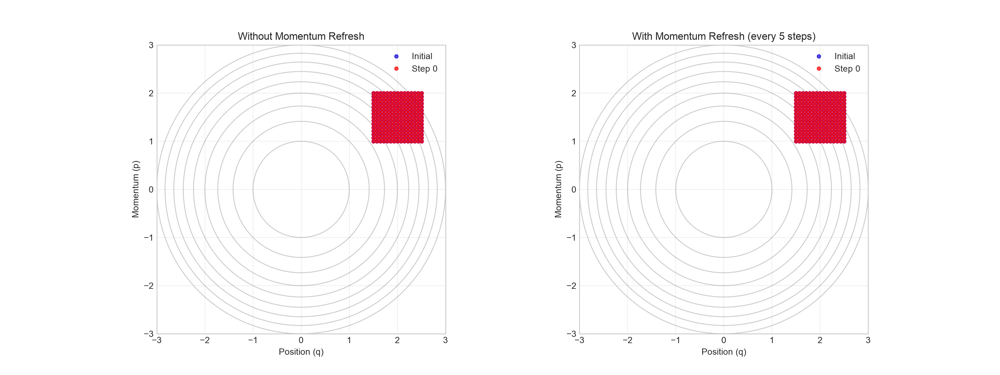
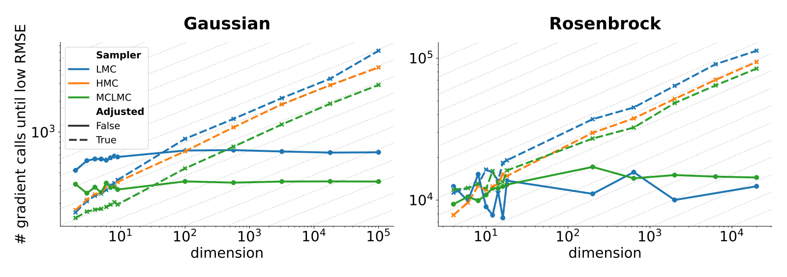
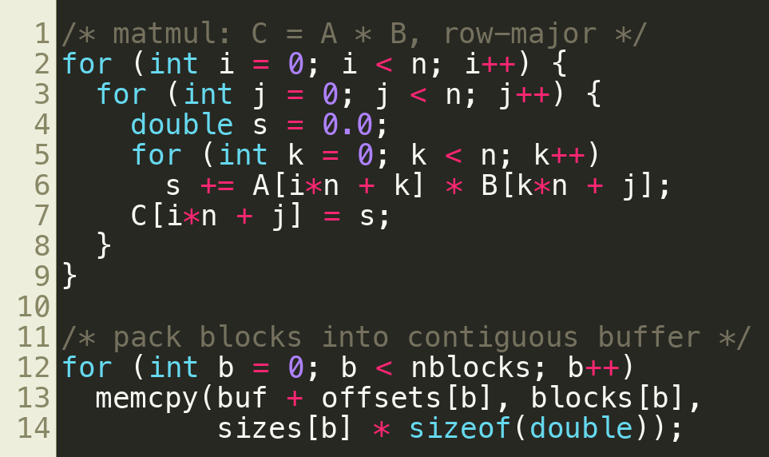

## Background {data-edge="off"}

:::: {.columns}
::: {.column width="42%"}
- [[S]{.strand-mark} Bayesian cognitive science / deep learning (Stanford)]{.strand-s}
- [[F]{.strand-mark} Industry: functional programming (Analog Devices)]{.strand-f}
- [[P]{.strand-mark} Current: Sampling for the physical sciences (UC Berkeley)]{.strand-p}
:::
::: {.column width="58%"}
::: {.center-block}
::: {.research-triangle data-triangle="all"}
:::
:::
:::
::::

## Roadmap {data-edge="all"}

:::: {.columns}
::: {.column width="50%"}
1. HMC for a spin–fermion model \
   [[Statistics]{.strand-s} + [Physics]{.strand-p}]{.edge-pair}
2. Functional reactive programming \
   [[Statistics]{.strand-s} + [Functional Programming]{.strand-f}]{.edge-pair}
3. Typed fusion \
   [[Functional Programming]{.strand-f} + [Physics]{.strand-p}]{.edge-pair}
:::
::: {.column width="50%"}
::: {.center-block}
::: {.research-triangle data-triangle="none"}
:::
:::
:::
::::

## [Statistics]{.strand-s} + [Physics]{.strand-p} {data-edge="stats-physics"}
::: {.center-block}
::: {.research-triangle data-triangle="stats-physics"}
:::
:::

## Sampling is the shared bottleneck {data-edge="stats-physics"}

:::: {.columns}
::: {.column width="33%"}
**Bayes**

$$
p(\theta\mid y)
=
\frac{p(y\mid\theta)\,p(\theta)}{p(y)}
$$

Need samples from the posterior when $p(y)$ is intractable.
:::
::: {.column width="33%"}
**Stat.~mech.**

$$
p(x)
=
\frac{e^{-\beta H(x)}}{Z}
$$

Need samples from the Boltzmann distribution when $Z$ is intractable.
:::
::: {.column width="34%"}
**Quantum (path integral)**

$$
\operatorname{Tr}(O\rho)
\;\longrightarrow\;
\mathbb{E}_{\text{paths}}[O]
$$

In $d{+}1$ dimensions, observables become expectations under a distribution over paths.
:::
::::

## Same problem, different dialects {data-edge="stats-physics"}

:::: {.columns}
::: {.column width="55%"}
Parallel names across fields:

| Chemistry / CM | Statistics |
|----------------|------------|
| DMC | SMC |
| VMC | variational inference |
| MD / HMC | HMC |

Occasionally ideas **cross**:

- HMC invented for **lattice gauge theory** (1980s)
- Ported to **Bayesian statistics** (1990s)
- Now a workhorse in Stan / NumPyro / BlackJAX — with new innovations on the stats side
:::
::: {.column width="45%"}
::: {.muted}
Dual language is a feature: techniques can travel both ways.
:::
:::
::::

## HMC dynamics {data-edge="stats-physics"}

Leapfrog on a Gaussian target: phase-space trajectory and energy.

{fig-alt="Discretized HMC trajectory with energy conservation" width="100%"}

[Left: $(q,p)$ on energy contours. Right: $H(q,p)$ vs step — nearly conserved.]{.muted}

## Measure preservation {data-edge="stats-physics"}

:::: {.columns}
::: {.column width="50%"}
{fig-alt="Measure preservation with and without momentum refresh"}

[Volume preservation of the flow (with / without momentum refresh).]{.muted}
:::
::: {.column width="50%"}
{fig-alt="Momentum refresh mixing in phase space"}

[Momentum refresh mixes across energy shells.]{.muted}
:::
::::

## Accelerating HMC {data-edge="stats-physics"}

Two insights from our group (Seljak lab):

1. **Different dynamics** — target the **microcanonical** ensemble (equal weight on an energy shell), with a kinetic energy chosen so the position marginal is still the target.
2. **No Metropolis adjustment** — skip MH; control asymptotic bias by tuning step size (EEVPD), trading a little bias for much lower variance in high dimension.

:::: {.columns}
::: {.column width="50%"}
{fig-alt="Gradient cost vs dimension: adjusted vs unadjusted"}

[Adjusted cost $\sim d^{1/4}$; unadjusted stays flat.]{.muted}
:::
::: {.column width="50%"}
{fig-alt="Bias–variance tradeoff for unadjusted HMC"}

[Bias–variance: controlled bias, larger ESS.]{.muted}
:::
::::

## Back to physics: a spin–fermion model {data-edge="stats-physics"}

Collaboration with **Peter Lunts** (formerly CCQ).

Apply unadjusted / microcanonical HMC to a lattice **spin–fermion** model of electronic structure.

Why this problem is a good stress test — two variance sources:

1. **Disorder** — quenched randomness in AFM exchanges; expectations require averaging over disorder realizations.
2. **Hutchinson trace trick** — fermionic observables estimated by stochastic traces; each sample carries Monte Carlo noise in the gradient / observable.

:::: {.columns}
::: {.column width="55%"}
Schematic action:

$$
S[\psi,\bar\psi,n]
=
S_{\mathrm{F}}[\psi,\bar\psi]
+
S_{\mathrm{b}}[n]
+
g\, n\cdot \bar\psi\,\sigma\,\psi
$$
:::
::: {.column width="45%"}
::: {.muted}
Unadjusted microcanonical HMC is attractive when gradients are noisy and dimension is large.
:::
:::
::::

## Results: fermionic observables {data-edge="stats-physics"}

From *Fast Accurate Quantum Monte Carlo without Metropolis Adjustment*:

{fig-alt="Fermion occupation, efficiency ratio, and bias diagnostics" width="100%"}

[$n(\mathbf{k})$; uMCLMC / aHMC efficiency; asymptotic bias $b_a$ and diagnostic $b_\epsilon$.]{.muted}

## Results: efficiency vs $\lambda$ {data-edge="stats-physics"}

:::: {.columns}
::: {.column width="55%"}
{fig-alt="ESS per gradient vs lambda for uMCLMC, uLMC, aHMC"}
:::
::: {.column width="45%"}
- Unadjusted **uMCLMC** / **uLMC** beat adjusted HMC by roughly an order of magnitude in ESS per gradient
- Accuracy matched (bias controlled by step-size tuning)
- Gains grow with system size
:::
::::

## [Statistics]{.strand-s} + [Functional Programming]{.strand-f} {data-edge="stats-fp"}

::: {.center-block}
::: {.research-triangle data-triangle="stats-fp"}
:::
:::

## The naïve workflow {data-edge="stats-fp"}

A natural way to do statistical programming:

1. Derive the model on a whiteboard (the Markov kernels you want: prior, likelihood, filter, …)
2. Hand-write a program that implements those kernels

Laborious — and risky:

- No guarantee of a **link** between the mathematical model and the running program
- Every change to the model reopens the derivation

## Probabilistic programming {data-edge="stats-fp"}

**Idea:** specify the *model* as code; automate the derivation of the inference method.

:::: {.columns}
::: {.column width="45%"}
whiteboard → program

[hand-derived kernels]{.muted}
:::
::: {.column width="10%"}
::: {.center-block}
⇒
:::
:::
::: {.column width="45%"}
model-as-code → inference

[compiler / library derives the sampler]{.muted}
:::
::::

**Stan** is the canonical example: write a generative model; get HMC for free.

## Warm-up: static particle detection {data-edge="stats-fp"}

A particle at unknown position $x$; one noisy observation $y$.

:::: {.columns}
::: {.column width="55%"}
```haskell
-- monad-bayes style
detect :: MonadInfer m => Double -> m Double
detect y = do
  x <- normal 0 1              -- prior
  score (normalPdf x 0.5 y)    -- likelihood
  return x                     -- posterior sample
```
:::
::: {.column width="45%"}
$$
\begin{aligned}
x &\sim \mathrm{N}(0,1) \\
y \mid x &\sim \mathrm{N}(x, 0.5^2)
\end{aligned}
$$

[Model = generative story + conditioning.]{.muted}
:::
::::

## Many inference methods {data-edge="stats-fp"}

Same model; many ways to draw from $p(x\mid y)$:

:::: {.columns}
::: {.column width="50%"}
- Exact conjugate update
- Importance sampling / SMC
- Metropolis–Hastings
- **HMC** (Stan’s default)
- Variational inference
:::
::: {.column width="50%"}
The PPL’s job: **choose / derive** an inference method from the model code.

[Stan ≈ HMC for static models.]{.muted}

[What about models that unfold in **time**?]{.muted}
:::
::::

## A PPL for stochastic processes {data-edge="stats-fp"}

Stan targets **static** models (batch data, fixed dimension).

I've been building a probabilistic programming language for **stochastic processes**: models that unfold in time, with streaming observations and online inference.

Built in Haskell by fusing

- **functional reactive programming** — signal functions over time
- **probabilistic programming** — sampling, conditioning, SMC

## Demo: prior dynamics {data-edge="stats-fp"}

:::: {.columns}
::: {.column width="46%"}
::: {.frp-demo-slot data-frp-stage="prior"}
:::

::: {.frp-demo-caption}
Teal = latent position (prior only)
:::
:::
::: {.column width="54%"}
```haskell
prior :: () >--> Position
prior = proc _ -> do
  x <- stochasticOscillator 0 0 -< 1
  y <- stochasticOscillator 0 0 -< 1
  returnA -< V2 x y
```

[A noisy harmonic oscillator — a stochastic process.]{.muted}
:::
::::

## Demo: observation model {data-edge="stats-fp"}

:::: {.columns}
::: {.column width="46%"}
::: {.frp-demo-slot data-frp-stage="obs"}
:::

::: {.frp-demo-caption}
Coral = noisy observations
:::
:::
::: {.column width="54%"}
```haskell
observationModel ::
  Position >--> Observation
observationModel = proc p -> do
  nx <- noise -< ()
  ny <- noise -< ()
  returnA -< p + V2 nx ny
  where
    noise = constM (normal 0 std)
```
:::
::::

## Demo: the inference problem {data-edge="stats-fp"}

:::: {.columns}
::: {.column width="46%"}
::: {.frp-demo-slot data-frp-stage="hidden"}
:::

::: {.frp-demo-caption}
Latent hidden — only observations remain
:::

Infer $p(\mathrm{position}_t \mid \mathrm{obs}_{\le t})$.
:::
::: {.column width="54%"}
```haskell
posterior ::
  Observation >-/-> Position
posterior = proc obs -> do
  latent <- prior -< ()
  observe -<
    likelihood obs latent
  returnA -< latent
```

[Unnormalized: model + conditioning, not yet a sampler.]{.muted}
:::
::::

## Demo: automated inference {data-edge="stats-fp"}

:::: {.columns}
::: {.column width="46%"}
::: {.frp-demo-slot data-frp-stage="particles"}
:::

::: {.frp-demo-caption}
Indigo = posterior particles from SMC
:::
:::
::: {.column width="54%"}
```haskell
inference ::
  Observation >--> [(Position, Weight)]
inference =
  particleFilter params {n = 100}
    posterior
```

[Same model code; SMC is derived by the library — analogous to Stan automating HMC.]{.muted}
:::
::::

## [Functional Programming]{.strand-f} + [Physics]{.strand-p} {data-edge="fp-physics"}

::: {.center-block}
::: {.research-triangle data-triangle="fp-physics"}
:::
:::

## An unknown unknown {data-edge="fp-physics"}

Programming language theory — $\lambda$-calculus, dependent types, the Curry–Howard isomorphism — is largely an **unknown unknown** for physicists.

Historically understandable:

- Computational problems were bottlenecked by **speed**
- Low-level control of hardware was the scarce resource
- So the culture optimized for Fortran / C / CUDA, not for expressive specification

## A new bottleneck: code complexity {data-edge="fp-physics"}

Performance still matters — but **complexity** is increasingly the limiter.

What we want is **compositionality**: glue correct pieces into larger correct pieces.

**Example:** tensor-network algorithms.

- Often written for a fixed lattice / geometry
- Generalizing over **graph topology** (trees, grids, arbitrary graphs) means the same contraction / update idea must be stated abstractly
- Without that abstraction, every geometry is a rewrite

## Separate specification from implementation {data-edge="fp-physics"}

**Applied stats before probabilistic programming languages (PPLs):**

:::: {.columns}
::: {.column width="46%"}
{height=140px}

[maths]{.muted}
:::
::: {.column width="8%"}
::: {.center-block}
→
:::
:::
::: {.column width="46%"}
{height=140px}

[code — `model + inference` fused]{.muted}
:::
::::

Derive on a whiteboard, then distill into code that **combines** the model and the inference method.

**PPLs:** tease the two apart — specify the model; automate / choose the inference (Stan, …).

**Physics:** the same two parts are still disjoint — mathematical description (e.g. linear maps) vs. implementation (arrays)

## Type-driven development {data-edge="fp-physics"}

> There was a theorem I formalized, and there was a certain constant 12 that came out… and this 12 had to be carried all through the proof… a few weeks later someone said we can improve this 12 to 11… when this happens with pen and paper… there can be subtle things that you didn't realize about 12 that you didn't realize you were taking advantage of.
>
> [But once formalized], you change the 12 to 11, you run the compiler, and of the thousands of lines you have, 90% of them still work and there's a couple underlined in red… It immediately isolates which steps you need changed… If you program things correctly, most of your lines will not be red.
>
> — Terence Tao (on Lean formalization)

## Same idea in physics {data-edge="fp-physics"}

Change the type a Krylov solver is allowed to act on — the checker shows what else must break.

- Refactors become local and guided
- Not “find every array of the wrong shape by hand”
- Types as a live interface between maths and code

## Linear algebra, two views {data-edge="fp-physics"}

:::: {.columns}
::: {.column width="50%"}
**Computational**

- A tensor *is* an array
- Layout, strides, dtype
- Realization fixed up front
:::
::: {.column width="50%"}
**Mathematical**

- A tensor is a multilinear map - Many realizations: dense, sparse, blocked, symmetry-reduced, …
- Choose the representation later
:::
::::

Specifying the math first makes it natural to **swap realizations** without rewriting the algorithm.

## Case study: $SU(2)$ representations {data-edge="fp-physics"}

A representation is a vector space with a group action.
Irreps are the indecomposable pieces; a general rep is their sum.

```lean
-- Lean / mathlib sketch
structure Representation (G V) where
  ρ : G → (V →ₗ[ℂ] V)
  map_one : ρ 1 = id
  map_mul : ρ (g * h) = ρ g ∘ₗ ρ h

-- V ≅ ⊕ⱼ  (irrep ⱼ) ⊗ (multiplicity)
-- the group acts on each irrep
```

## Symmetric tensors = intertwiners {data-edge="fp-physics"}

A symmetry-respecting map $A\to B$ is a linear map that **commutes with the action**:

```lean
def Intertwiner (ρA ρB) :=
  { f : A →ₗ[ℂ] B //
      ∀ g, f ∘ₗ ρA g = ρB g ∘ₗ f }
```

Hom-space dictionary:

$$
\mathrm{Hom}(A,B)
\;\cong\;
A^{*}\otimes B
\;\cong\;
\bigoplus_{j} m_{j}\,(\text{irrep }j)
$$

The maps that commute with $G$ are exactly the **trivial sector** ($j{=}0$).

## What the maths buys you {data-edge="fp-physics"}

Once $\mathrm{Hom}_G(A,B)$ is the trivial sector of $A^{*}\otimes B$:

- Storage collapses to a handful of blocks (Schur)
- Shapes are dictated by fusion rules, not bookkeeping
- The same abstract API can target dense arrays *or* symmetry-reduced tensors

[Next: track those blocks in the type system (`typed-fusion` / Lean).]{.muted}

## Outlook {data-edge="all"}

[TODO: synthesis across the three strands — [S]{.strand-s} · [F]{.strand-f} · [P]{.strand-p}]{.todo}

## Fit with CCQ {data-edge="all"}

[TODO: collaborations, software culture, future directions]{.todo}
