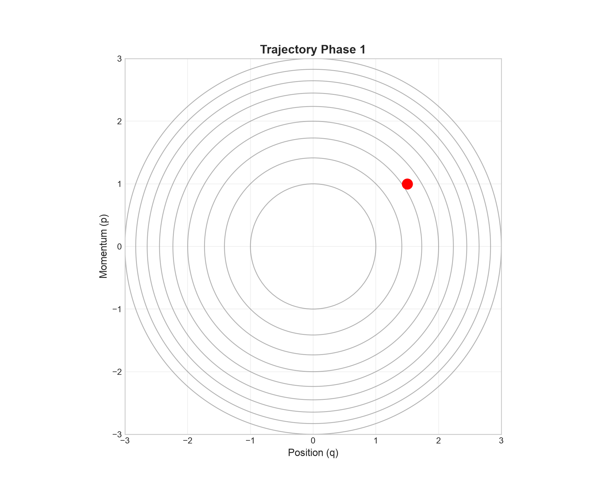
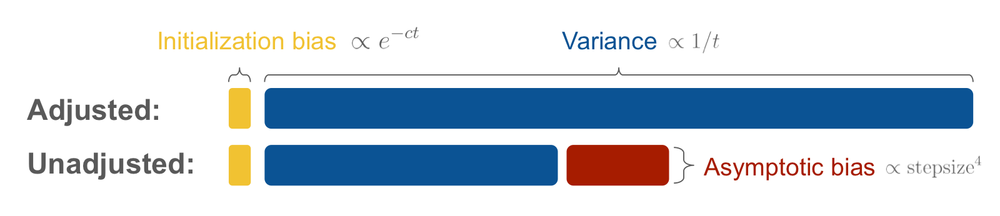
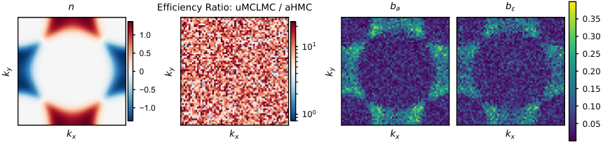
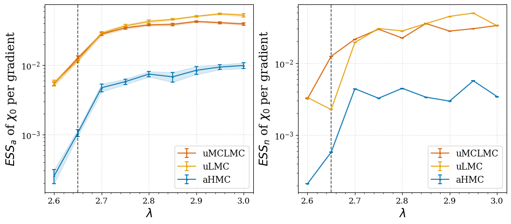

## Background {data-edge="all"}

:::: {.columns}
::: {.column width="42%"}
- [[S]{.strand-mark} Bayesian cognitive science / deep learning (Stanford)]{.strand-s}
- [[F]{.strand-mark} Industry: functional programming (Analog Devices)]{.strand-f}
- [[P]{.strand-mark} Current: Sampling for the physical sciences (UC Berkeley)]{.strand-p}
:::
::: {.column width="58%"}
::: {.center-block}
::: {.research-triangle data-triangle="all"}
:::
:::
:::
::::

## Roadmap {data-edge="all"}

:::: {.columns}
::: {.column width="50%"}
1. HMC for a spin–fermion model \
   [[Statistics]{.strand-s} + [Physics]{.strand-p}]{.edge-pair}
2. Functional reactive programming \
   [[Statistics]{.strand-s} + [Functional Programming]{.strand-f}]{.edge-pair}
3. Typed fusion \
   [[Functional Programming]{.strand-f} + [Physics]{.strand-p}]{.edge-pair}
:::
::: {.column width="50%"}
::: {.center-block}
::: {.research-triangle data-triangle="none"}
:::
:::
:::
::::

## [Statistics]{.strand-s} + [Physics]{.strand-p} {data-edge="stats-physics"}
::: {.center-block}
::: {.research-triangle data-triangle="stats-physics"}
:::
:::

## Sampling is the shared bottleneck {data-edge="stats-physics"}

:::: {.columns}
::: {.column width="33%"}
**Bayes**

$$
p(\theta\mid y)
=
\frac{p(y\mid\theta)\,p(\theta)}{p(y)}
$$

Need samples from the posterior when $p(y)$ is intractable.
:::
::: {.column width="33%"}
**Stat.~mech.**

$$
p(x)
=
\frac{e^{-\beta H(x)}}{Z}
$$

Need samples from the Boltzmann distribution when $Z$ is intractable.
:::
::: {.column width="34%"}
**Quantum (path integral)**

$$
\operatorname{Tr}(O\rho)
\;\longrightarrow\;
\mathbb{E}_{\text{paths}}[O]
$$

In $d{+}1$ dimensions, observables become expectations under a distribution over paths.
:::
::::

## Same problem, different dialects {data-edge="stats-physics"}

:::: {.columns}
::: {.column width="55%"}
Parallel names across fields:

| Chemistry / CM | Statistics |
|----------------|------------|
| DMC | SMC |
| VMC | variational inference |
| MD / HMC | HMC |

Occasionally ideas **cross**:

- HMC invented for **lattice gauge theory** (1980s)
- Ported to **Bayesian statistics** (1990s)
- Now a workhorse in Stan / NumPyro / BlackJAX — with new innovations on the stats side
:::
::: {.column width="45%"}
::: {.muted}
Dual language is a feature: techniques can travel both ways.
:::
:::
::::

## HMC dynamics {data-edge="stats-physics"}

Leapfrog on a Gaussian target: phase-space trajectory and energy.

{fig-alt="Discretized HMC trajectory with energy conservation" width="100%"}

[Left: $(q,p)$ on energy contours. Right: $H(q,p)$ vs step — nearly conserved.]{.muted}

## Measure preservation {data-edge="stats-physics"}

:::: {.columns}
::: {.column width="50%"}
{fig-alt="Measure preservation with and without momentum refresh"}

[Volume preservation of the flow (with / without momentum refresh).]{.muted}
:::
::: {.column width="50%"}
{fig-alt="Momentum refresh mixing in phase space"}

[Momentum refresh mixes across energy shells.]{.muted}
:::
::::

## Accelerating HMC {data-edge="stats-physics"}

Two insights from our group (Seljak lab):

1. **Different dynamics** — target the **microcanonical** ensemble (equal weight on an energy shell), with a kinetic energy chosen so the position marginal is still the target.
2. **No Metropolis adjustment** — skip MH; control asymptotic bias by tuning step size (EEVPD), trading a little bias for much lower variance in high dimension.

:::: {.columns}
::: {.column width="50%"}
{fig-alt="Gradient cost vs dimension: adjusted vs unadjusted"}

[Adjusted cost $\sim d^{1/4}$; unadjusted stays flat.]{.muted}
:::
::: {.column width="50%"}
{fig-alt="Bias–variance tradeoff for unadjusted HMC"}

[Bias–variance: controlled bias, larger ESS.]{.muted}
:::
::::

## Back to physics: a spin–fermion model {data-edge="stats-physics"}

Collaboration with **Peter Lunts** (formerly CCQ).

Apply unadjusted / microcanonical HMC to a lattice **spin–fermion** model of electronic structure.

Why this problem is a good stress test — two variance sources:

1. **Disorder** — quenched randomness in AFM exchanges; expectations require averaging over disorder realizations.
2. **Hutchinson trace trick** — fermionic observables estimated by stochastic traces; each sample carries Monte Carlo noise in the gradient / observable.

:::: {.columns}
::: {.column width="55%"}
Schematic action:

$$
S[\psi,\bar\psi,n]
=
S_{\mathrm{F}}[\psi,\bar\psi]
+
S_{\mathrm{b}}[n]
+
g\, n\cdot \bar\psi\,\sigma\,\psi
$$
:::
::: {.column width="45%"}
::: {.muted}
Unadjusted microcanonical HMC is attractive when gradients are noisy and dimension is large.
:::
:::
::::

## Results: fermionic observables {data-edge="stats-physics"}

From *Fast Accurate Quantum Monte Carlo without Metropolis Adjustment*:

{fig-alt="Fermion occupation, efficiency ratio, and bias diagnostics" width="100%"}

[$n(\mathbf{k})$; uMCLMC / aHMC efficiency; asymptotic bias $b_a$ and diagnostic $b_\epsilon$.]{.muted}

## Results: efficiency vs $\lambda$ {data-edge="stats-physics"}

:::: {.columns}
::: {.column width="55%"}
{fig-alt="ESS per gradient vs lambda for uMCLMC, uLMC, aHMC"}
:::
::: {.column width="45%"}
- Unadjusted **uMCLMC** / **uLMC** beat adjusted HMC by roughly an order of magnitude in ESS per gradient
- Accuracy matched (bias controlled by step-size tuning)
- Gains grow with system size
:::
::::

## [Statistics]{.strand-s} + [Functional Programming]{.strand-f} {data-edge="stats-fp"}

::: {.center-block}
::: {.research-triangle data-triangle="stats-fp"}
:::
:::

## The naïve workflow {data-edge="stats-fp"}

A natural way to do statistical programming:

1. Derive the model on a whiteboard (the Markov kernels you want: prior, likelihood, filter, …)
2. Hand-write a program that implements those kernels

Laborious — and risky:

- No guarantee of a **link** between the mathematical model and the running program
- Every change to the model reopens the derivation

## Probabilistic programming {data-edge="stats-fp"}

**Idea:** specify the *model* as code; automate the derivation of the inference method.

:::: {.columns}
::: {.column width="45%"}
whiteboard → program

[hand-derived kernels]{.muted}
:::
::: {.column width="10%"}
::: {.center-block}
⇒
:::
:::
::: {.column width="45%"}
model-as-code → inference

[compiler / library derives the sampler]{.muted}
:::
::::

**Stan** is the canonical example: write a generative model; get HMC for free.

## A PPL for stochastic processes {data-edge="stats-fp"}

Stan targets **static** models (batch data, fixed dimension).

I've been building a probabilistic programming language for **stochastic processes**: models that unfold in time, with streaming observations and online inference.

Built in Haskell by fusing

- **functional reactive programming** — signal functions over time
- **probabilistic programming** — sampling, conditioning, SMC

## Demo: prior dynamics {data-edge="stats-fp"}

:::: {.columns}
::: {.column width="46%"}
::: {.frp-demo-slot data-frp-stage="prior"}
:::

::: {.frp-demo-caption}
Teal = latent position (prior only)
:::
:::
::: {.column width="54%"}
```haskell
prior :: () >--> Position
prior = proc _ -> do
  x <- brownianMotion1D -< ()
  y <- brownianMotion1D -< ()
  returnA -< V2 x y
```

[A time-varying distribution — a stochastic process.]{.muted}
:::
::::

## Demo: observation model {data-edge="stats-fp"}

:::: {.columns}
::: {.column width="46%"}
::: {.frp-demo-slot data-frp-stage="obs"}
:::

::: {.frp-demo-caption}
Coral = noisy observations
:::
:::
::: {.column width="54%"}
```haskell
observationModel ::
  Position >--> Observation
observationModel = proc p -> do
  nx <- noise -< ()
  ny <- noise -< ()
  returnA -< p + V2 nx ny
  where
    noise = constM (normal 0 std)
```
:::
::::

## Demo: the inference problem {data-edge="stats-fp"}

:::: {.columns}
::: {.column width="46%"}
::: {.frp-demo-slot data-frp-stage="hidden"}
:::

::: {.frp-demo-caption}
Latent hidden — only observations remain
:::

Infer $p(\mathrm{position}_t \mid \mathrm{obs}_{\le t})$.
:::
::: {.column width="54%"}
```haskell
posterior ::
  Observation >-/-> Position
posterior = proc obs -> do
  latent <- prior -< ()
  observe -<
    likelihood obs latent
  returnA -< latent
```

[Unnormalized: model + conditioning, not yet a sampler.]{.muted}
:::
::::

## Demo: automated inference {data-edge="stats-fp"}

:::: {.columns}
::: {.column width="46%"}
::: {.frp-demo-slot data-frp-stage="particles"}
:::

::: {.frp-demo-caption}
Indigo = posterior particles from SMC
:::
:::
::: {.column width="54%"}
```haskell
inference ::
  Observation >--> [(Position, Weight)]
inference =
  particleFilter params {n = 100}
    posterior
```

[Same model code; SMC is derived by the library — analogous to Stan automating HMC.]{.muted}
:::
::::

## [Functional Programming]{.strand-f} + [Physics]{.strand-p} {data-edge="fp-physics"}

::: {.center-block}
::: {.research-triangle data-triangle="fp-physics"}
:::
:::

## Little contact so far {data-edge="fp-physics"}

Functional programming and programming-language theory have made **little contact** with computational physics.

:::: {.columns}
::: {.column width="50%"}
**Understandable**

- Performance is the priority
- You want hardware control
- Imperative / low-level tools dominate
:::
::: {.column width="50%"}
**But appealing**

- Specs of algorithms can be very rich
- Lots of structure to encode
- Types / abstraction can pull their weight
:::
::::

## A mathematically rich domain {data-edge="fp-physics"}

**Example:** group representations (e.g. $SU(2)$ spins in quantum many-body physics).

Symmetry-respecting maps (intertwiners) carry nontrivial structure:

- Tensor products fuse: $\tfrac12\otimes\tfrac12 \;\cong\; 1\oplus 0$
- Data lives in **blocks** indexed by irreps
- Shapes are dictated by representation theory — not by ad hoc bookkeeping

[Natural question: can the type system track this structure?]{.muted}

## Length-checked linear algebra {data-edge="fp-physics"}

Start simple: dimensions in the types.

```haskell
vectorExample :: C 3
vectorExample = vec (1,2,3)

tensorProductExample :: C 3 ⊗ C 2
tensorProductExample =
  vec (1,2,3) ⊗ vec (4,5)
```

Wrong length ⇒ **compile-time** error — not a silent reshape bug at runtime.

## Irreps as types {data-edge="fp-physics"}

Same idea, but the “length” is a representation:

```haskell
irrepExample ::
  VectorOf SU2 (Irrep (Spin (1/2)))
irrepExample = vec (1,2)

directSumOfIrrepsExample ::
  Unfused SU2
    (Irrep (Spin (1/2))
       :⊕: Irrep (Spin (3/2)))
directSumOfIrrepsExample =
  (vec (1,2), vec (3,4,5,6))
```

[$\mathbb{C}^2$ for spin-$\tfrac12$; $\mathbb{C}^4$ for spin-$\tfrac32$ — checked by the type.]{.muted}

## Fusion at the type level {data-edge="fp-physics"}

Tensor products of irreps **fuse**: $\tfrac12\otimes\tfrac12 \;\cong\; 0\oplus 1$.

```haskell
unfused :: Unfused SU2
  (Irrep (Spin (1/2)) :⊗: Irrep (Spin (1/2)))
unfused = mat ((1,2),(5,6))   -- ℂ² ⊗ ℂ²

fused :: Fused SU2
  (Irrep (Spin (1/2)) :⊗: Irrep (Spin (1/2)))
fused = (konst 1, vec (4,5,6))  -- ℂ¹ ⊕ ℂ³
```

Haskell computes the fused shape **at compile time**; a wrong block size is rejected before you run anything.

## Keeping only the trivial sector {data-edge="fp-physics"}

Intertwiners live in the invariant ($j{=}0$) subspace — Schur's lemma as a type:

```haskell
trivialSectorExample ::
  Sym SU2
    (Irrep (Spin (1/2)) :⊗: Irrep (Spin (1/2)))
trivialSectorExample = konst 2   -- ℂ¹

-- 3/2 ⊗ 1/2 = 1 ⊕ 2  (no singlet)
trivialSectorExample2 ::
  Sym SU2
    (Irrep (Spin (3/2)) :⊗: Irrep (Spin (1/2)))
trivialSectorExample2 = EmptyFTrees
```

## From fusion to categories {data-edge="fp-physics"}

Once objects are typed, morphisms compose by the **same** abstract law in every fusion category.

```haskell
-- Mac Lane ladder on names ⌜f⌝, ⌜g⌝:
composeNames @Fib  nf ng
composeNames @Ising nf ng
```

$$
\lceil f\rceil\otimes\lceil g\rceil
\;\xrightarrow{\;\alpha,\;\varepsilon,\;\lambda\;}\;
\lceil g\circ f\rceil
$$

Fibonacci and Ising share one implementation — the mathematics supplies the abstraction boundary.

## Design principle {data-edge="fp-physics"}

The mathematics shows how to **abstract** and **design** the software:

- Representation theory ⇒ block shapes in the types
- Fusion rules ⇒ checked at compile time
- Compact closed structure ⇒ one compositional API across theories (SU(2), Fib, Ising, …)

[Code that looks like the maths — not an imperative simulation with the same numeric answers.]{.muted}

## Outlook {data-edge="all"}

[TODO: synthesis across the three strands — [S]{.strand-s} · [F]{.strand-f} · [P]{.strand-p}]{.todo}

## Fit with CCQ {data-edge="all"}

[TODO: collaborations, software culture, future directions]{.todo}
