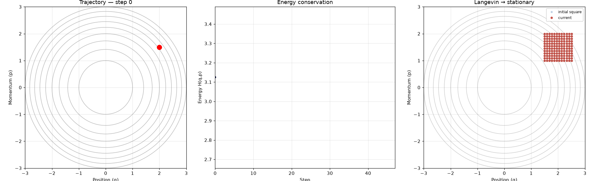
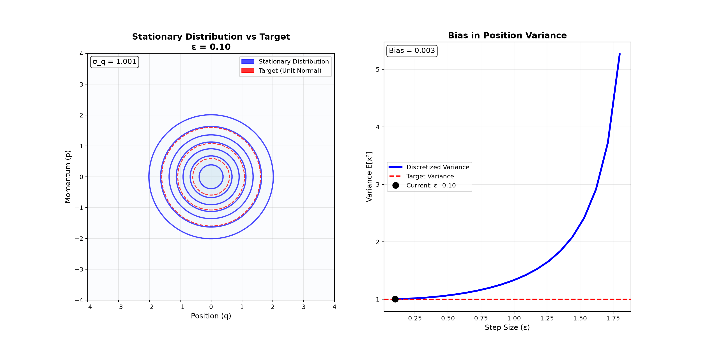
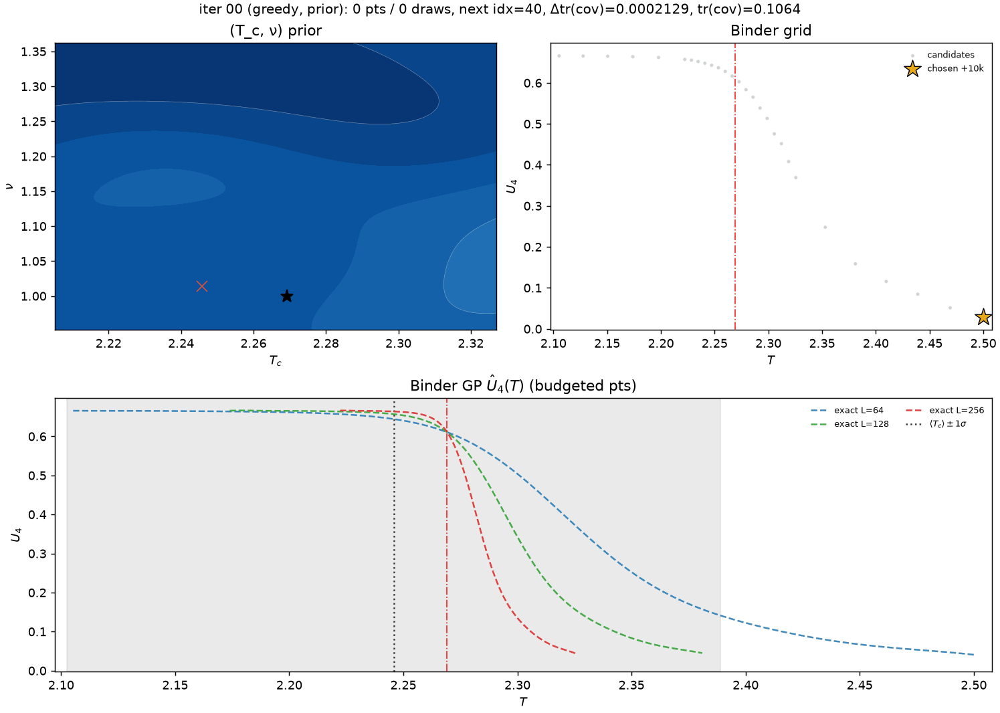

## Background {data-edge="off"}

:::: {.columns}
::: {.column width="42%"}
- [[S]{.strand-mark} Bayesian cognitive science / deep learning (Stanford)]{.strand-s}
- [[F]{.strand-mark} Industry: functional programming (Analog Devices)]{.strand-f}
- [[P]{.strand-mark} Current: Sampling for the physical sciences (UC Berkeley)]{.strand-p}
:::
::: {.column width="58%"}
::: {.center-block}
::: {.research-triangle .triangle-lg data-triangle="all"}
:::
:::
:::
::::

## Roadmap {data-edge="off"}

:::: {.columns}
::: {.column width="42%"}
1. Fast HMC for a spin–fermion model \
   [[Statistics]{.strand-s} + [Physics]{.strand-p}]{.edge-pair}
2. Reactive probabilistic programming \
   [[Statistics]{.strand-s} + [Functional Programming]{.strand-f}]{.edge-pair}
3. Formalization of physics \
   [[Functional Programming]{.strand-f} + [Physics]{.strand-p}]{.edge-pair}
:::
::: {.column width="58%"}
::: {.center-block}
::: {.research-triangle .triangle-lg data-triangle="all"}
:::
:::
:::
::::

## [Statistics]{.strand-s} + [Physics]{.strand-p} {data-edge="stats-physics"}
::: {.center-block}
::: {.research-triangle data-triangle="stats-physics"}
:::
:::

## A common problem {data-edge="stats-physics"}

:::: {.columns}
::: {.column width="33%"}
**Bayesian Statistics**

$$
\underbrace{p(\theta\mid y)}_{\text{posterior}}
=
\frac{
\overbrace{p(y\mid\theta)}^{\text{likelihood}}
\,
\overbrace{p(\theta)}^{\text{prior}}
}{p(y)}
$$

Need to calculate expectation with respect to the posterior.
:::
::: {.column width="33%"}
**Statistical mechanics**

$$
p(x)
=
\frac{e^{-\beta H(x)}}{Z}
$$

Need to calculate expectation to predict chemical/material properties.
:::
::: {.column width="34%"}
**Quantum (path integral)**

$$
\operatorname{Tr}(O\rho)
\;\longrightarrow\;
\mathbb{E}_{\text{paths}}[O]
$$

In $d{+}1$ dimensions, observables become expectations under a distribution over paths. The trace becomes an expectation.
:::
::::

## Exchange of ideas is valuable  {data-edge="stats-physics"}

:::: {.columns}
::: {.column width="48%"}
Occasionally ideas **cross** between fields:

- Hybrid Monte Carlo (HMC) invented for **lattice gauge theory** (1980s)
- Ported to **Bayesian statistics** as Hamiltonian Monte Carlo (1990s)
- Now a workhorse in Stan / NumPyro / BlackJAX — with new innovations on the stats side
:::
::: {.column width="52%"}
::: {.hmc-cross}
<svg viewBox="0 0 420 200" role="img" aria-label="HMC crossed from physics to statistics; can cross back">
  <defs>
    <marker id="hmc-arrow" viewBox="0 0 10 10" refX="9" refY="5" markerWidth="7" markerHeight="7" orient="auto-start-reverse">
      <path d="M 0 1.5 L 9 5 L 0 8.5 Z" fill="#1c1b19"/>
    </marker>
    <marker id="hmc-arrow-back" viewBox="0 0 10 10" refX="9" refY="5" markerWidth="7" markerHeight="7" orient="auto-start-reverse">
      <path d="M 0 1.5 L 9 5 L 0 8.5 Z" fill="#6a6760"/>
    </marker>
  </defs>
  <rect x="18" y="58" width="118" height="72" rx="10" fill="#3d6aad" fill-opacity="0.12" stroke="#3d6aad" stroke-width="2.5"/>
  <text x="77" y="100" text-anchor="middle" font-family="Avenir Next, Segoe UI, Helvetica, Arial, sans-serif" font-size="20" font-weight="600" fill="#3d6aad">Physics</text>
  <rect x="284" y="58" width="118" height="72" rx="10" fill="#2a9a93" fill-opacity="0.12" stroke="#2a9a93" stroke-width="2.5"/>
  <text x="343" y="100" text-anchor="middle" font-family="Avenir Next, Segoe UI, Helvetica, Arial, sans-serif" font-size="20" font-weight="600" fill="#2a9a93">Stats</text>
  <!-- forward: physics → stats -->
  <path d="M 145 78 C 200 52, 220 52, 275 78" fill="none" stroke="#1c1b19" stroke-width="3.2" marker-end="url(#hmc-arrow)"/>
  <text x="210" y="48" text-anchor="middle" font-family="Avenir Next, Segoe UI, Helvetica, Arial, sans-serif" font-size="14" font-weight="600" fill="#1c1b19">HMC (1980s → 90s)</text>
  <!-- back: stats → physics -->
  <path d="M 275 118 C 220 148, 200 148, 145 118" fill="none" stroke="#6a6760" stroke-width="2.6" stroke-dasharray="7 5" marker-end="url(#hmc-arrow-back)"/>
  <text x="210" y="168" text-anchor="middle" font-family="Avenir Next, Segoe UI, Helvetica, Arial, sans-serif" font-size="14" font-weight="600" fill="#6a6760">cross back?</text>
</svg>
:::
:::
::::

## HMC dynamics: Gaussian example {data-edge="stats-physics"}

::: {.eq-hero}
$$
{\color{#2a9a93}{\pi(q)}}\propto e^{-q^{2}/2},
\qquad
{\color{#3d6aad}{H(q,p)}}=\tfrac{1}{2}q^{2}+\tfrac{1}{2}p^{2}
$$
:::

{fig-alt="HMC trajectory, energy conservation, and square of points thermalizing under Langevin dynamics" width="100%"}

[Left: leapfrog trajectory. Middle: $H$ vs step. Right: a square of points under Langevin → stationary.]{.muted}

## Idea 1: target microcanonical distribution {data-edge="stats-physics"}

:::: {.columns}
::: {.column width="50%"}
Density:

$$
{\color{#2a9a93}{\pi(x)}} = \frac{1}{Z}\,e^{-{\color{#2a9a93}{L(x)}}}
$$

Hamiltonian (log-kinetic):

$$
{\color{#3d6aad}{H(x,p)}}
=
{\color{#2a9a93}{L(x)}}
+
(d-1)\log\|p\|
$$

Microcanonical joint (energy shell):

$$
p_{\mathrm{mc}}(x,p)
\propto
\delta\!\big({\color{#3d6aad}{H(x,p)}}-E\big)
$$
:::
::: {.column width="50%"}
Dynamics ($u=p/\|p\|$):

$$
\begin{aligned}
\dot x &= u \\
\dot u &=
-\frac{\bigl(I-uu^\top\bigr)\nabla {\color{#2a9a93}{L}}(x)}{d-1}
\end{aligned}
$$

Update:

$$
\begin{aligned}
x &\leftarrow x + \varepsilon\,u \\[0.35em]
u &\leftarrow
\frac{
u+(\sinh\delta+(e\cdot u)(\cosh\delta-1))\,e
}{
\cosh\delta+(e\cdot u)\sinh\delta
}
\end{aligned}
$$

[$\delta=\varepsilon\|\nabla L\|/(d{-}1)$,\; $e=-\nabla L/\|\nabla L\|$]{.muted}
:::
::::

[Robnik, Cohn-Gordon, Seljak, NeurIPS 2025.]{.muted}

## Idea 2: Avoid Metropolis-Hastings {data-edge="stats-physics"}

Skip the Metropolis–Hastings correction. Discretization bias is **controlled** by tuning step size to target energy error variance, trading a little bias for much lower variance in high dimension.

:::: {.columns}
::: {.column width="58%"}
{fig-alt="Stationary distribution of discretized Gaussian HMC as step size increases"}

[As $\varepsilon$ grows, the leapfrog stationary drifts from the target Gaussian.]{.muted}
:::
::: {.column width="42%"}
::: {.eq-compact}
$$
\mathbb{E}_{\mathrm{MC}}\!\big[(\hat{\mu}_f-\mathbb{E}_\rho[f])^{2}\big]
=
\mathrm{Bias}[\hat{\mu}_f]^{2}
+
\mathrm{Var}[\hat{\mu}_f]
$$
:::

{fig-alt="Bias–variance tradeoff for unadjusted HMC"}

[Trade-off: gain bias but lose variance.]{.muted}
:::
::::

[Robnik, Cohn-Gordon, Seljak, ICML 2026.]{.muted}

## Back to physics: a spin–fermion model {data-edge="stats-physics"}

Collaboration with **Peter Lunts** (formerly CCQ). Lattice **spin–fermion** model of electronic structure.


:::: {.columns}
::: {.column width="55%"}
::: {.sf-lattice}
<svg viewBox="0 0 360 300" role="img" aria-label="2D square lattice with phi on sites and g on links">
  <g class="sf-links" stroke="#1c1b19" stroke-width="2.2" stroke-linecap="round">
    <line x1="60" y1="60" x2="160" y2="60"/>
    <line x1="160" y1="60" x2="260" y2="60"/>
    <line x1="60" y1="160" x2="160" y2="160"/>
    <line x1="160" y1="160" x2="260" y2="160"/>
    <line x1="60" y1="260" x2="160" y2="260"/>
    <line x1="160" y1="260" x2="260" y2="260"/>
    <line x1="60" y1="60" x2="60" y2="160"/>
    <line x1="60" y1="160" x2="60" y2="260"/>
    <line x1="160" y1="60" x2="160" y2="160"/>
    <line x1="160" y1="160" x2="160" y2="260"/>
    <line x1="260" y1="60" x2="260" y2="160"/>
    <line x1="260" y1="160" x2="260" y2="260"/>
  </g>
  <g fill="#c4782e" font-family="Palatino Linotype, Palatino, Georgia, serif" font-size="17" font-style="italic" text-anchor="middle">
    <text x="110" y="48">g<tspan baseline-shift="sub" font-size="12" font-style="normal">12</tspan></text>
    <text x="42" y="118" text-anchor="end">g<tspan baseline-shift="sub" font-size="12" font-style="normal">14</tspan></text>
  </g>
  <g fill="#3d6aad">
    <circle cx="60" cy="60" r="9"/>
    <circle cx="160" cy="60" r="9"/>
    <circle cx="260" cy="60" r="9"/>
    <circle cx="60" cy="160" r="9"/>
    <circle cx="160" cy="160" r="9"/>
    <circle cx="260" cy="160" r="9"/>
    <circle cx="60" cy="260" r="9"/>
    <circle cx="160" cy="260" r="9"/>
    <circle cx="260" cy="260" r="9"/>
  </g>
  <g fill="#3d6aad" font-family="Palatino Linotype, Palatino, Georgia, serif" font-size="18" font-style="italic" text-anchor="middle">
    <text x="188" y="178">φ<tspan baseline-shift="sub" font-size="13" font-style="normal">22</tspan></text>
    <text x="288" y="278">φ<tspan baseline-shift="sub" font-size="13" font-style="normal">33</tspan></text>
  </g>
</svg>
:::
:::
::: {.column width="45%"}
- $\phi_{ij}$: bosonic / Hubbard–Stratonovich field (sites)
- $g_{ij}$: couplings on links (clean or disordered)
- integrate out fermions → determinant; introduce pseudofermions $\psi$

$$
p(\phi,\psi)
\propto
e^{-S(\phi,\psi)}
$$

:::
::::

## Results {data-edge="stats-physics"}

From [*Cohn-Gordon, Pescia, Robnik, Hearth, Seljak, Lunts*, NeurIPS 2026](https://arxiv.org/html/2611.10187v1):

:::: {.columns}
::: {.column width="52%"}
{.results-compact fig-alt="Fermion occupation and efficiency ratio uMCLMC over aHMC"}

[$n(\mathbf{k})$; efficiency ratio.]{.muted}
:::
::: {.column width="48%"}
{fig-alt="ESS per gradient vs lambda for uMCLMC, uLMC, aHMC"}

Future directions:

- parallel methods
- systems with sign problem, DMFT, VMC

:::
::::

## [Statistics]{.strand-s} + [Physics]{.strand-p} {data-edge="stats-physics"}

::: {.center-block}
::: {.research-triangle data-triangle="stats-physics"}
:::
:::

## Bayesian Scaling Analysis {.bsa-split data-edge="stats-physics"}

:::: {.columns}
::: {.column width="58%"}
{fig-alt="Active learning loop: Tc-nu posterior, Binder grid, and GP fit over iterations"}

[Active learning on $m, m^2, m^4$: posterior, design points, GP fit.]{.muted}
:::
::: {.column width="42%"}
::: {.eq-compact}
$$
{\color{#3d6aad}{m_i}}
=
L_i^{-\color{#2a9a93}{\beta}/\color{#2a9a93}{\nu}}\,
\color{#2a9a93}{f}\!\Big(
\tfrac{T_i-\color{#2a9a93}{T_c}}{\color{#2a9a93}{T_c}}\,
L_i^{1/\color{#2a9a93}{\nu}}
\Big)
+
\varepsilon_i
$$

$$
f\sim\mathrm{GaussianProcess}(0,\,k)
$$
:::

::: {.design-legend .design-legend-stack}
<span><span class="swatch unk"></span>unknown $\theta=(T_c,\nu,\beta,f)$</span>\
<span><span class="swatch obs"></span>data $y=\{m_i\}$</span>\
<span><span class="swatch known"></span>known $(L_i,T_i)$, noise $\sigma_i$</span>
:::
:::
::::

## [Statistics]{.strand-s} + [Functional Programming]{.strand-f} {data-edge="stats-fp"}

::: {.center-block}
::: {.research-triangle data-triangle="stats-fp"}
:::
:::

## The naïve workflow {data-edge="stats-fp"}

The old way of doing computational statistics:

1. Derive the model on a whiteboard (the Markov kernels you want: prior, likelihood, filter, …)
2. Hand-write a program that implements those kernels

The downsides:

- Hard to read: model and inference tangled together in the code
- No guarantee of a **link** between the mathematical model and the running program
- Every change to the model reopens the derivation

## Probabilistic programming {.code-lg data-edge="stats-fp"}

**Idea:** specify the *model* as code; automate inference (e.g.\ Stan → HMC).

Example — particle at unknown $x$, one noisy observation $y$:

:::: {.columns}
::: {.column width="55%"}
```haskell
prior :: Distribution m => m Float
prior = normal 0 1

likelihood :: Float -> Float -> Float
likelihood x y = normalPdf x 0.5 y

posterior :: Measure m => Float -> m Float
posterior y = do
  x <- prior               
  condition (likelihood x y)     
  return x

sampler :: Float -> Sampler Float
sampler y = hmc (posterior y) 
```

[Haskell]{.muted .code-lang}
:::
::: {.column width="45%"}
$$
\begin{aligned}
\texttt{prior}&:\quad
x \sim \mathrm{N}(0,1) \\[0.35em]
\texttt{likelihood}&:\quad
p(y\mid x)=\mathrm{N}(y;\,x,0.5^2) \\[0.35em]
\texttt{posterior}&:\quad
p(x\mid y)\propto p(x)\,p(y\mid x)
\end{aligned}
$$

[Write the model; `hmc` turns the posterior into a sampler.]{.muted}
:::
::::

## Dynamical systems {.frp-hero data-edge="stats-fp"}

::: {.frp-demo-slot data-frp-stage="prior"}
:::

## Noisy observations {.frp-hero data-edge="stats-fp"}

::: {.frp-demo-slot data-frp-stage="obs"}
:::

## Particle filter {.frp-hero data-edge="stats-fp"}

::: {.frp-demo-slot data-frp-stage="particles"}
:::

## Naive implementation {.code-lg .pf-messy data-edge="stats-fp"}

::: {.pf-row}
```{.text code-line-numbers="false"}
init x_i ~ N(0, I)
for t = 1..T:
  for each particle i:
    x_i <- x_i + v_i dt + σ dW
    w_i <- N(y_t; x_i, R)
  resample {x_i} ~ w
```

::: {.pf-problems}
**Problems**

- scalability: control parameters, hierarchical variables, concurrent processes, feedback
- doesn't unify algorithms (particle filter vs.\ Kalman filter)
:::
:::

## The conceptual picture ($\cong$ Feynman–Kac) {data-edge="stats-fp"}

::: {.concept-rows}
:::: {.concept-row}
::: {.concept-desc}
**prior:** a distribution over trajectories (a stochastic process)
:::
::: {.concept-type}
`Distribution(Time → Position)`
:::
::::

:::: {.concept-row}
::: {.concept-desc}
**likelihood:** distribution over observation trajectories as a (causal) function of the true trajectory
:::
::: {.concept-type}
`(Time → Position) → Distribution(Time → Obs)`
:::
::::

:::: {.concept-row}
::: {.concept-desc}
**posterior:** true trajectory as a function of the observation trajectory
:::
::: {.concept-type}
`(Time → Obs) → Distribution(Time → Position)`
:::
::::

:::: {.concept-row}
::: {.concept-desc}
**particle filter:** transforms the posterior into a distribution over a population of particles
:::
::: {.concept-type}
`Time → Distribution(List(Position))`
:::
::::
:::

## From prior to particle filter {.code-lg .frp-stack data-edge="stats-fp"}

:::: {.columns}
::: {.column width="62%"}
**Prior** — simulation is a sample from distribution over trajectories:

```haskell
prior :: SignalFunction () Position
prior = _ -> do
  x <- stochasticOscillator
  y <- stochasticOscillator
  return (vec (x, y))
```

**Condition** — `observe` multiplies by $g(Y_{<t}\mid X_{<t})$:

```haskell
posterior :: SignalFunctionUnnormed Observation Position
posterior = obs -> do
  latent <- prior
  observe (likelihood obs latent)
  return -< latent
```

**Infer** — particle filter derived by the library:

```haskell
inference :: SignalFunction Observation [Position]
inference = particleFilter posterior
```
:::
::: {.column width="38%"}
::: {.frp-demo-slot data-frp-stage="particles"}
:::

[Same model; filter like Stan automating HMC.]{.muted}
:::
::::

**Advantages of this approach:**

- simplifies and unifies algorithms (what is a particle filter, filtering vs. smoothing)
- extensibility

## [Functional Programming]{.strand-f} + [Physics]{.strand-p} {data-edge="fp-physics"}

::: {.center-block}
::: {.research-triangle data-triangle="fp-physics"}
:::
:::

## Ideas from programming language theory {data-edge="fp-physics"}


::: {.math-becomes-code}
::: {.mbc-panel .mbc-math}
{fig-alt="Handwritten maths on a blackboard"}
:::
::: {.mbc-panel .mbc-code}
```stan
data {
  real y;
}
parameters {
  real x;
}
model {
  x ~ normal(0, 1);
  y ~ normal(x, 0.5);
}
```
:::
:::

**Physics:** math and code still disjoint

Programming language theory rarely intersects with computational physics. 

Historically understandable: main bottleneck was **speed**.

But code complexity is now also a bottleneck (e.g. success of ITensor)

[Bernardy & Jansson, *Domain-Specific Tensor Languages*, JFP, 2025]{.muted}

## Lean and Type-driven development {data-edge="fp-physics"}

> There was a theorem I formalized, and there was a certain constant 12 that came out… and this 12 had to be carried all through the proof… a few weeks later someone said we can improve this 12 to 11… when this happens with pen and paper… there can be subtle things that you didn't realize about 12 that you didn't realize you were taking advantage of.
>
> [But once formalized], you change the 12 to 11, you run the compiler, and of the thousands of lines you have, 90% of them still work and there's a couple underlined in red… It immediately isolates which steps you need changed… If you program things correctly, most of your lines will not be red.
>
> — Terence Tao (on Lean formalization)

## Type driven development in physics {.code-lg data-edge="fp-physics"}

**Problem:** find $x$ solving $Ax=b$ ($A$ SPD) — conjugate gradient.

Fixed size — $n{=}3$:

```haskell
conjugateGradient
  :: Float -> Mat 3 3 -> Array 3 -> Array 3
```

Generalize: *polymorphic* over dimension:

```haskell
conjugateGradient
  :: forall (n :: Nat) . Float -> Mat n n -> Array n -> Array n
```

Most abstract — any inner-product space $v$ (same algorithm):

```haskell
conjugateGradient
  :: forall (v :: Type) . ( VectorSpace v, InnerSpace v, Rational (Scalar v) )
  => Float -> (LinearMap v v) -> v -> v
```

This code is extensible to new representations of vectors and maps.


## Linear algebra as code {.code-lg data-edge="fp-physics"}

A matrix is just one way of representing a linear map $f\colon a\to b \;\cong\; a^{*}\otimes b$.

:::: {.columns}
::: {.column width="48%"}
**Application** $f(v)$ — contraction along $a$:

$$
\begin{aligned}
v\otimes f
  &\in
    a\otimes(a^{*}\otimes b) \\
  &\xrightarrow{F^{-1}}
    (a\otimes a^{*})\otimes b \\
  &\xrightarrow{\varepsilon\otimes\mathrm{id}}
    \mathbf{1}\otimes b \\
  &\xrightarrow{\lambda}
    b\,.
\end{aligned}
$$
:::
::: {.column width="52%"}
```haskell
apply
  :: forall k a b .
  (CompactClosed k ⊗, Obj k a, Obj k b)
  => a -> (Dual a ⊗ b) -> b         
apply v f =
    lam                          
  . (counit ⊗ id)                
  . fInv                
  . (v ⊗ f)                      
```
:::
::::


## Linear Maps and Symmetries {.code-lg .tf-examples data-edge="fp-physics"}

Fix a group $G$ (e.g.\ $SU(2)$). Irreps $a,b,\ldots$ with carriers $V_a$:
$V \;\cong\; \bigoplus_{a} m_a\, V_a$,\; $\rho_a: G\to\mathrm{GL}(V_a)$.

::: {.eq-brace-row}
$V_a \multimap V_b \;\cong\; \bigl(V_a^{*}\otimes V_b\bigr) \;\cong\;$

<span class="math-underbrace">
$\displaystyle\bigoplus_{c} m_c\, V_c$
<svg class="ub-brace" viewBox="0 0 200 18" preserveAspectRatio="none" aria-hidden="true">
  <path d="M 3 1 V 6 C 3 12, 12 12, 18 12 H 82 C 92 12, 96 12, 100 17 C 104 12, 108 12, 118 12 H 182 C 188 12, 197 12, 197 6 V 1" fill="none" stroke="currentColor" stroke-width="2.2" stroke-linecap="round" stroke-linejoin="round"/>
</svg>
<span class="ub-label">Schur: keep $c{=}0$ only</span>
</span>
:::

:::: {.columns}
::: {.column width="58%"}
```haskell
x :: C 2 ⊗ C 3
x = vec (1,2) ⊗ vec (4,5,6)

-- ½ ⊗ ½ ≅ 0 ⊕ 1  (fused)
t :: Fused SU2 (Irrep (Spin (1/2)) ⊗ Irrep (Spin (1/2)))
t = (konst 1, vec (4,5,6))

-- keep only the trivial sector (intertwiners)
s :: Sym SU2 (Irrep (Spin (1/2)) ⊗ Irrep (Spin (1/2)))
s = konst 2
```
:::
::: {.column width="42%"}
::: {.eq-compact}
$$
\begin{aligned}
x &\in \mathbb{C}^{2}\otimes\mathbb{C}^{3} \\
x &= \begin{pmatrix}1\\2\end{pmatrix}
      \otimes
      \begin{pmatrix}4\\5\\6\end{pmatrix}
\\[0.35em]
t &\in 0\oplus 1
\;\cong\;
\tfrac12\otimes\tfrac12 \\
t &= \bigl(1,\;(4,5,6)\bigr)
\\[0.35em]
s &\in \bigl(\tfrac12\otimes\tfrac12\bigr)^{G} \\
s &= 2
\end{aligned}
$$
:::
:::
::::

[Wrong lengths / wrong sectors fail to compile.]{.muted}

## Summary {data-edge="all"}

:::: {.columns}
::: {.column width="48%"}
::: {.center-block}
::: {.research-triangle data-triangle="all"}
:::
:::
:::
::: {.column width="52%"}
1. **Fast HMC** for a spin–fermion model \
   [[S]{.strand-s}+[P]{.strand-p}]{.edge-pair} — microcanonical / unadjusted sampling at scale

2. **Reactive** probabilistic programming \
   [[S]{.strand-s}+[F]{.strand-f}]{.edge-pair} — decouple time, model, and inference (FRP)

3. **Typed** formal methods for physics \
   [[F]{.strand-f}+[P]{.strand-p}]{.edge-pair} — math via types $\to$ extensible code
:::
::::

## Thanks {data-edge="all"}

::: {.thanks-grid}
::: {.thanks-person}
{fig-alt="Peter Lunts"}
[Peter Lunts]{.name}
:::
::: {.thanks-person}
{fig-alt="Jakob Robnik"}
[Jakob Robnik]{.name}
:::
::: {.thanks-person}
{fig-alt="Uroš Seljak"}
[Uroš Seljak]{.name}
:::
::: {.thanks-person}
{fig-alt="Dries Sels"}
[Dries Sels]{.name}
:::
::: {.thanks-person}
{fig-alt="Gabriel Pescia"}
[Gabriel Pescia]{.name}
:::
::: {.thanks-person}
{fig-alt="Michael Lindsey"}
[Michael Lindsey]{.name}
:::
:::

## Appendix: Hamiltonian Monte Carlo {data-edge="off"}

:::: {.columns}
::: {.column width="50%"}
Density:

$$
{\color{#2a9a93}{\pi(q)}} = \frac{1}{Z}\,e^{-{\color{#2a9a93}{U(q)}}}
$$

Hamiltonian:

$$
{\color{#3d6aad}{H(q,p)}} = {\color{#2a9a93}{U(q)}} + \tfrac{1}{2}\,p^\top M^{-1}p
$$

$$
\begin{aligned}
p_{\mathrm{HMC}}(q,p)
&\propto e^{-{\color{#3d6aad}{H(q,p)}}} \\
\int p_{\mathrm{HMC}}(q,p)\,dp
&= {\color{#2a9a93}{\pi(q)}}
\end{aligned}
$$
:::
::: {.column width="50%"}
Dynamics:

$$
\begin{aligned}
\dot q &= \nabla_p {\color{#3d6aad}{H}} = M^{-1}p \\
\dot p &= -\nabla_q {\color{#3d6aad}{H}} = -\nabla {\color{#2a9a93}{U}}(q)
\end{aligned}
$$

Leapfrog:

$$
\begin{aligned}
p &\leftarrow p - \tfrac{\varepsilon}{2}\nabla {\color{#2a9a93}{U}}(q) \\
q &\leftarrow q + \varepsilon\, M^{-1}p \\
p &\leftarrow p - \tfrac{\varepsilon}{2}\nabla {\color{#2a9a93}{U}}(q)
\end{aligned}
$$
:::
::::
